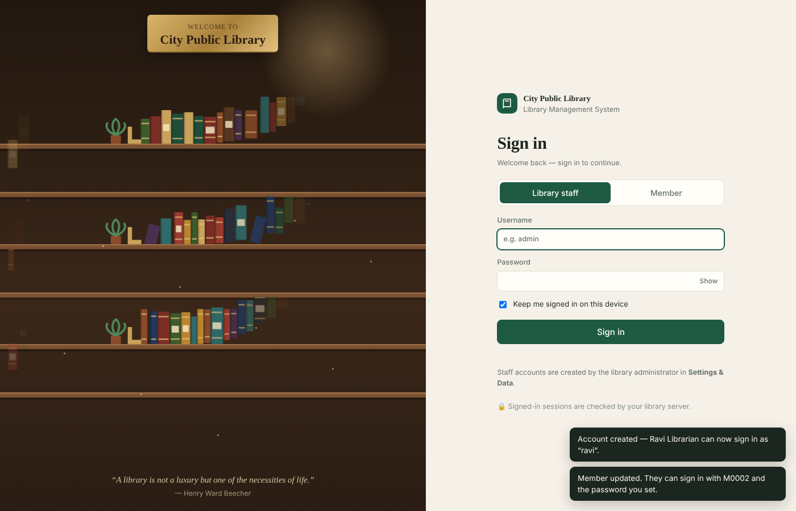
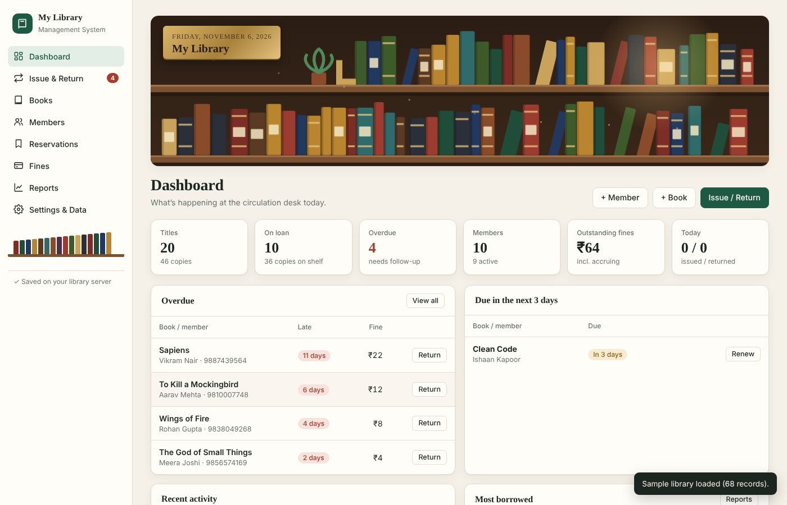
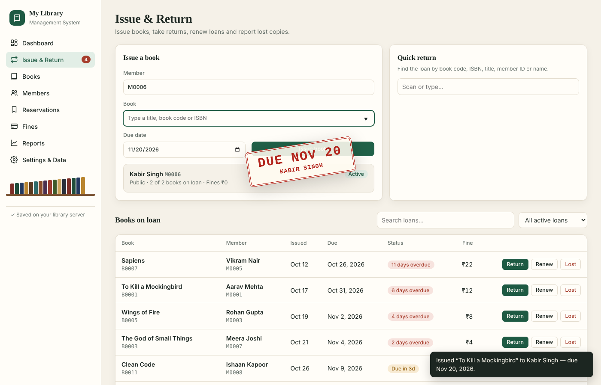
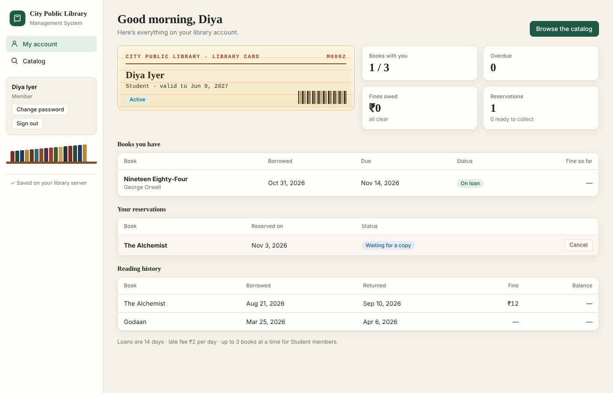
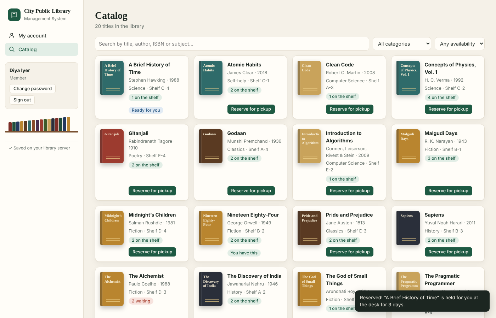
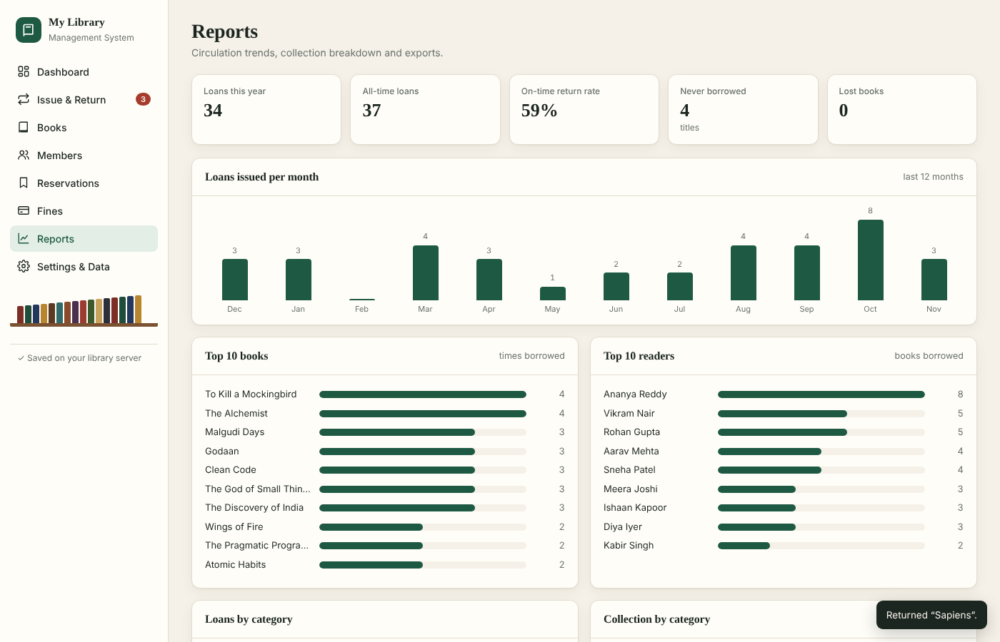

# 📚 Library Management System

A complete, self-hosted library management system with a library-themed interface:
catalog, members, issue/return/renew, reservations, fines, reports and CSV exports.
It has separate logins for administrators, librarians and members.
The server is plain Node.js with **zero dependencies**, and it runs anywhere with Docker.



| Dashboard | Issue a book |
|---|---|
|  |  |
| **Member dashboard** | **Member catalog** |
|  |  |



## Quick start

```bash
git clone https://github.com/astiksar20/library-management-system.git
cd library-management-system
docker compose up -d --build
```

Then open **http://localhost:8080** and create your administrator account.


## Run it

You need [Docker Desktop](https://www.docker.com/products/docker-desktop/) (or Docker Engine + Compose).
After cloning, run `docker compose up -d --build` and open **http://localhost:8080**.

To stop it: `docker compose down`. Your data stays in the `library-data` volume.

### Without Compose

```bash
docker build -t library-management-system .
docker run -d -p 8080:8080 -v library-data:/app/data --name library library-management-system
```

### Without Docker

You need Node.js 18 or newer. There are no packages to install.

```bash
node server.js
```

## First run & signing in

1. Open **http://localhost:8080**. The first time, you'll see **Set up your library**: enter the library name and create the **administrator** account.
2. Sign in as the administrator. Under **Settings & Data → Staff accounts**, add your librarians.
3. To let a member use the member portal, open the member, click **Edit**, and set a **portal password**. They sign in on the **Member** tab with their member ID (for example `M0001`) or email, plus that password.

| Role | What they can do |
|---|---|
| **Administrator** | Everything: settings, staff accounts, backup/restore, delete all data, and all librarian work |
| **Librarian** | Dashboard, issue/return/renew, books, members, reservations, fines, reports |
| **Member** | Their own dashboard (books they have, due dates, fines, history), browsing the catalog, and reserving or cancelling reservations |

The server enforces sign-in and roles:
- Every data request needs a valid session.
- Members only receive their own records.
- Password hashes are never sent to the browser.
- Sign-in attempts are rate-limited.

Sessions last 12 hours, or 30 days if you tick "Keep me signed in".

**Locked out?** In `docker-compose.yml`, uncomment `LMS_RESET_ADMIN=new-password-here` and run `docker compose up -d`. Sign in as `admin` with that password, then remove the line and run `docker compose up -d` again.

## Features

- **Catalog**: add, edit and delete books (ISBN, category, publisher, shelf, copies, price), search and filter, and bulk-import from CSV.
- **Members**: Student, Faculty, Staff and Public member types, each with its own borrowing limit. Members have expiry dates and can be suspended or renewed. Each member has a library-card profile and can have a portal login.
- **Issue & Return**: issue books with checks for the borrowing limit, expired membership, unpaid fines, copy availability and held copies. You can return books (with damage charges), renew loans, report lost books (with a replacement charge) and do a quick return by searching. Each loan records which staff member issued and returned it.
- **Reservations**: members wait in a queue for a book. When a copy comes back, the next person in line is marked ready, and they get a set number of days to pick it up.
- **Fines**: a daily late fee with optional grace days. You can collect payments (Cash/UPI/Card), waive fines, and see accruing and collected totals.
- **Reports**: loans per month, top books and readers, category breakdowns, on-time return rate, and CSV exports.
- **Settings & Data**: library rules, staff accounts, JSON backup and restore, sample data, and a "delete all" option.

## Data & backups

- Live data is stored in `/app/data/library.json` inside the volume.
- The server makes a daily copy in `/app/data/backups/` and keeps the last 14 days.
- To copy the data out: `docker cp library-management-system:/app/data/library.json ./`
- You can also use **Settings & Data → Export backup** in the app.

## Security notes

- If the library is reachable from outside your own network, put it behind HTTPS (for example with Caddy or nginx as a reverse proxy), so passwords aren't sent in plain text.
- Restarting the server signs everyone out.

## Change the port

Edit `ports` in `docker-compose.yml`, for example `"3000:8080"`.

## Project structure

```
├── public/index.html     # the whole web app (HTML, CSS and JS in one file)
├── server.js             # Node.js server: API, login sessions, roles, JSON storage, backups
├── Dockerfile
├── docker-compose.yml
└── docs/screenshots/
```

## Tech

- Vanilla JavaScript single-page app, with no build step.
- Node.js `http` server, with no npm packages.
- Data is stored as JSON on a Docker volume, written atomically, with daily backups.
- Passwords are salted and iteratively hashed with SHA-256. Sessions use random bearer tokens.

## License

MIT. See [LICENSE](LICENSE).
